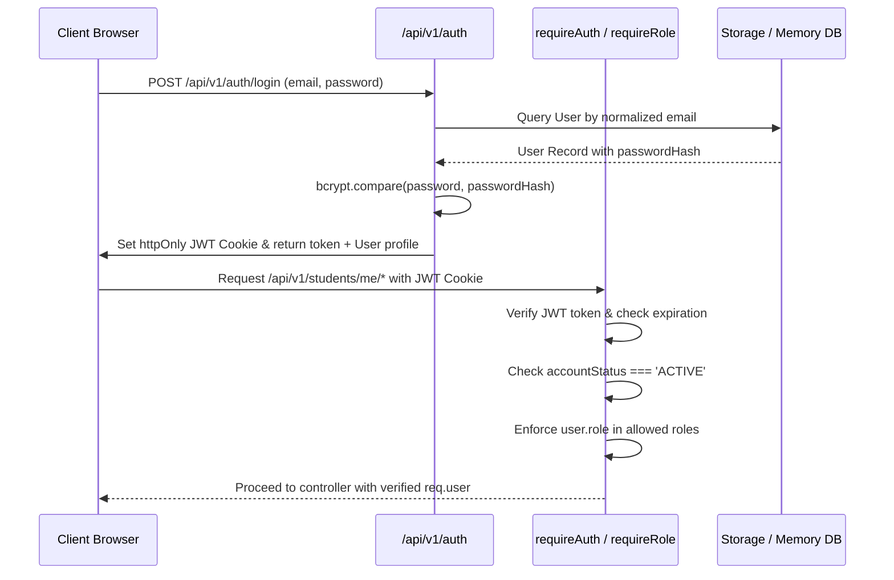

# B.Tech Student AI Learning Platform — Architecture & System Design

**Version:** 1.0.0  
**Phase:** Phase 1 (Foundation & Architecture)  
**Last Updated:** 2026-10-15  

---

## 1. Executive Overview

The **B.Tech Student AI Learning Platform** is a personalized, evidence-based academic operating system tailored for undergraduate engineering students. The platform harmonizes degree requirements, university syllabus structures, technical skills, laboratory work, continuous assessments, and career trajectories with a server-side Gemini AI orchestration layer.

---

## 2. Architectural Principles

1. **Role Model Isolation**:
   - Exactly two system roles: `SUPER_ADMIN` and `STUDENT`.
   - Strict server-side RBAC enforced via middleware (`requireRole`, `requireAuth`).
   - Tenant isolation: Every student access path is scoped strictly to `req.user.id`.

2. **Evidence-Based Personalization**:
   - Never fabricate student achievements, grades, or proficiency levels.
   - Self-reported skills remain explicitly categorized as self-reported until validated by quiz assessments, coding sandbox execution, or verified project evidence.

3. **Multi-Agent Readiness**:
   - Central `AgentRegistry` and `ToolRegistry` with role-aware and scope-governed tool definitions.
   - Multi-agent orchestration via `studentContextEngine` feeding targeted context chunks (never unbounded dumps).

4. **Layered Decoupling**:
   - Frontend UI: React 19, TypeScript, Vite, Tailwind CSS, Radix UI primitives, Lucide icons, Motion, TanStack Query.
   - Backend API: Express/TypeScript REST service under `/api/v1` with route-level controllers and isolated storage providers.
   - Event-Driven Synchrony: Pub/Sub event bus (`server/events/eventBus.ts`) propagating state mutations to downstream cache and recommendation engines without cyclic dependencies.

---

## 3. System Topology & Directory Structure

```text
b.tech-ai-learning-platform/
├── src/                          # Frontend Application (React 19 + Vite)
│   ├── api/                      # Centralized typed API clients (client.ts, authApi.ts, onboardingApi.ts, etc.)
│   ├── components/               # Shared design system components & layout shells (AppShell, AdminLayout)
│   ├── features/                 # Modular feature domains:
│   │   ├── admin/                # Super Admin console & student governance
│   │   ├── ai-agent/             # AI Tutor, interactive chat & tool views
│   │   ├── analytics/            # Academic performance analytics & tracking
│   │   ├── courses/              # Course catalogs, personalized modules & notes
│   │   ├── dashboard/            # Dynamic Student Dashboard
│   │   ├── documents/            # Document RAG, PDF/Office viewer & parser
│   │   ├── dsa/                  # DSA Problem bank & algorithm visualizers
│   │   ├── onboarding/           # 5-step / 10-step resumable onboarding wizard
│   │   ├── profile/              # Multi-tab student profile management
│   │   ├── quiz/                 # Adaptive quizzes & assessments
│   │   └── semester/             # Semester Command Center & syllabus explorer
│   ├── hooks/                    # Reusable React hooks (useAuth, useLocalStorage, etc.)
│   ├── lib/                      # Utilities, cn helper, formatters
│   ├── pages/                    # Route-level page components
│   └── tests/                    # End-to-end and integration test suites
├── server/                       # Backend Application (Node.js / Express / TypeScript)
│   ├── ai/                       # AI Layer:
│   │   ├── orchestration/        # AgentRegistry, Router, AgentDefinitions
│   │   ├── provider.ts           # Gemini API integration (@google/genai)
│   │   ├── service.ts            # AI service, prompt management, streaming
│   │   ├── tools.ts              # Controlled AI Tool Registry
│   │   └── studentContextEngine.ts# Student Context Assembly & Memory Service
│   ├── api/                      # Versioned REST APIs (/api/v1):
│   │   ├── router.ts             # Primary API router mounting all domain routes
│   │   └── routes/               # Domain route controllers (auth, onboarding, admin, ai, etc.)
│   ├── core/                     # Core configs, logger, typed AppError hierarchy
│   ├── events/                   # Central asynchronous EventBus & event contracts
│   ├── middleware/               # Auth, role validation, rate limiting, security headers, audit logging
│   ├── models/                   # Type definitions & entity models
│   ├── parsers/                  # Document parsing engine (PDF, DOCX, PPTX, TXT)
│   ├── services/                 # Domain business services (onboarding, courses, documents, dsa, etc.)
│   └── storage/                  # Storage abstraction & persistent JSON/Vault repository
├── docs/                         # Governance, architecture, and phase roadmaps
├── server.ts                     # Backend server entry point
└── vite.config.ts                # Vite build and development configuration
```

---

## 4. Authentication and Authorization Flow



---

## 5. Multi-Agent & AI Architecture

1. **AI Provider Abstraction (`server/ai/provider.ts`)**:
   - Primary: Google Gemini 2.5 Flash / Pro via `@google/genai`.
   - Fallback/Offline: Graceful degradation with mock simulation mode when `GEMINI_API_KEY` is not provisioned or quota is exhausted.

2. **Student Context Engine (`server/ai/studentContextEngine.ts`)**:
   - Gathers student-specific context:
     - Education details (Degree, Branch, Semester).
     - Active subjects & current syllabus units.
     - Declared & assessed technical skills.
     - Learning preferences (Explanation style, format, language).
     - Recent quiz attempts, weak topics, and active goals.
   - Formulates targeted system instructions for the AI Tutor and specialized agents without leaking unneeded data.

3. **Tool Registry (`server/ai/tools.ts`)**:
   - Provides safe, sandboxed tools: `get_student_context`, `get_semester_subjects`, `get_syllabus_topics`, `get_weak_topics`, `generate_quiz`, `create_note`, `schedule_revision`, `create_study_plan`.
   - Enforces ownership checks on every tool execution.

---

## Phase 5 update (2026-11-09)

Registration and the student profile now go through one central service (`server/services/studentProfile/`) with the
profile context API at `/api/v1/profile/me/*`. Firebase Authentication can replace the email/password provider when
configured; Supabase Postgres can replace the snapshot as the profile store. See `docs/phase-5/PROJECT_ARCHITECTURE.md`.
