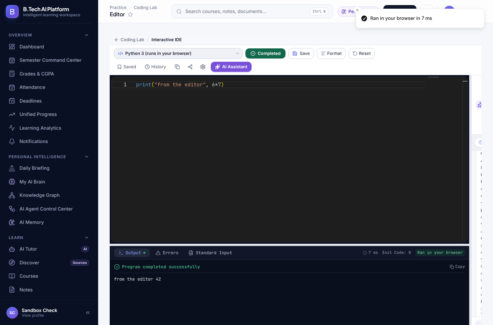
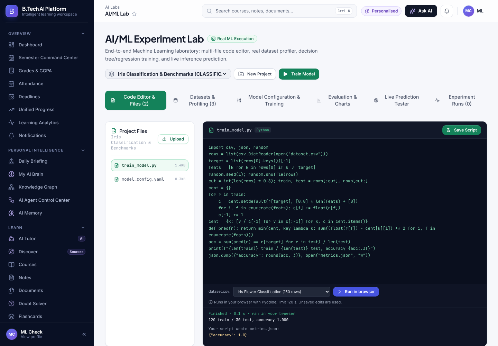

# Running code and training models without a server sandbox

The Vercel deployment has no isolated sandbox, so the server refuses to run student code there
(the rule is "never execute arbitrary student code directly inside the main application server").
This change runs Python and JavaScript **in the student's own browser** instead, in a sandbox that
cannot see the page, the sign-in or stored data. Nothing runs on our server.

## How it works

- Each run gets a fresh module Web Worker (`src/lib/browserSandbox/`). Python runs in Pyodide 0.27.7
  (CPython compiled to WebAssembly). JavaScript runs in the worker itself.
- Before student code starts, `lockDown()` removes `fetch`, `XMLHttpRequest`, `WebSocket`,
  `EventSource`, `importScripts`, `indexedDB`, `caches`, `BroadcastChannel`, `Worker` and the
  rest from the worker scope and from every prototype in its chain, so there is no network or storage.
  The worker never has the page's DOM, cookies or `localStorage`.
- The page stops the worker at the time limit (10 s for code, 120 s for ML training), so an infinite
  loop cannot hang the tab. Output is capped at 200,000 characters.
- The Pyodide core (about 14 MB) is copied from the npm package into `public/vendor/pyodide/` at
  install and at build, and served from our own domain. numpy, pandas and scikit-learn are fetched
  from the Pyodide CDN (`cdn.jsdelivr.net`) on first use, checked against the sha256 hashes in the
  lock file, and cached by the browser.
- The browser is used only when the server says it has no sandbox (`sandbox_unavailable`). A server
  with a real sandbox keeps running code itself, as before.

## Where it is used

| Place | What happens |
|---|---|
| Coding Lab | Python and JavaScript show "(runs in your browser)" in the language list. Run shows the output with a green "Ran in your browser" badge. C, C++ and Java still say running code is off on this server. |
| DSA problems | Run Code runs the public sample tests in the browser and compares output the same way the server does. Submit explains that graded submissions need the server's hidden tests, which cannot run here. |
| Lab records | Run executes in the browser, then saves the program, its output and its run time to the experiment, marked as a browser run. |
| Mock interviews | The code is saved on the server as before; the run happens in the browser. |
| ML Lab | Python files get a run panel. The chosen dataset is written as `dataset.csv` next to the script; files the script writes (`metrics.json`, `.csv`, `.txt`) are shown. The starter `train_model.py` is now a real pandas/scikit-learn script. |

## Tested

- `src/tests/browser_sandbox.test.ts` (9 tests): lock-down (including the prototype chain and that
  names cannot be put back), sample-test comparison and stop-on-error, which languages use the
  browser, `dataset.csv` quoting, and the lab endpoint storing a browser run (and refusing to change
  another student's experiment).
- In Chromium against a local server with the sandbox off (as on Vercel): Python with stdin, cleaned
  tracebacks, `js.fetch`/`XMLHttpRequest`/`indexedDB` all `None`, `pyfetch` failing, infinite loops
  stopped at the limit, files written by the script returned; JavaScript with `fetch` unreachable even
  through the prototype chain and `localStorage` undefined. Python starts in about 2 s.
- ML Lab: a model trained in plain Python on Iris (120 train / 30 test) printed its accuracy and wrote
  `metrics.json`.
- Full suite: 85 files, 1,189 tests passing. `tsc` clean. Build emits `dist/vendor/pyodide` and both workers.

## Limits, stated plainly

- **numpy, pandas and scikit-learn were not tested here.** The machine this was built on cannot reach
  `cdn.jsdelivr.net`. When the CDN is unreachable the run says which packages failed to download and
  the import fails; it never pretends a model trained. They will be checked on the live site after merge.
- C, C++ and Java still need a server sandbox. Graded DSA submissions (hidden tests) still need one too,
  because hidden tests cannot be sent to the browser without revealing them.
- Training is limited by the student's device: the built-in datasets take seconds, very large data will not fit.
