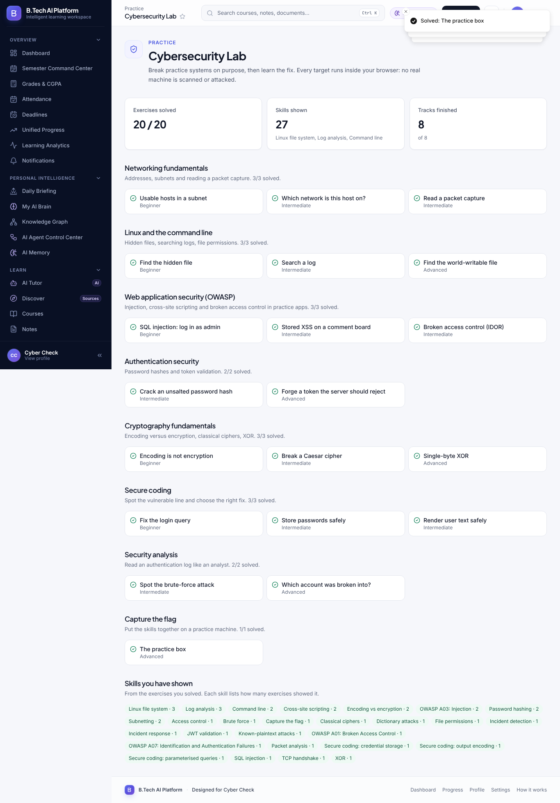
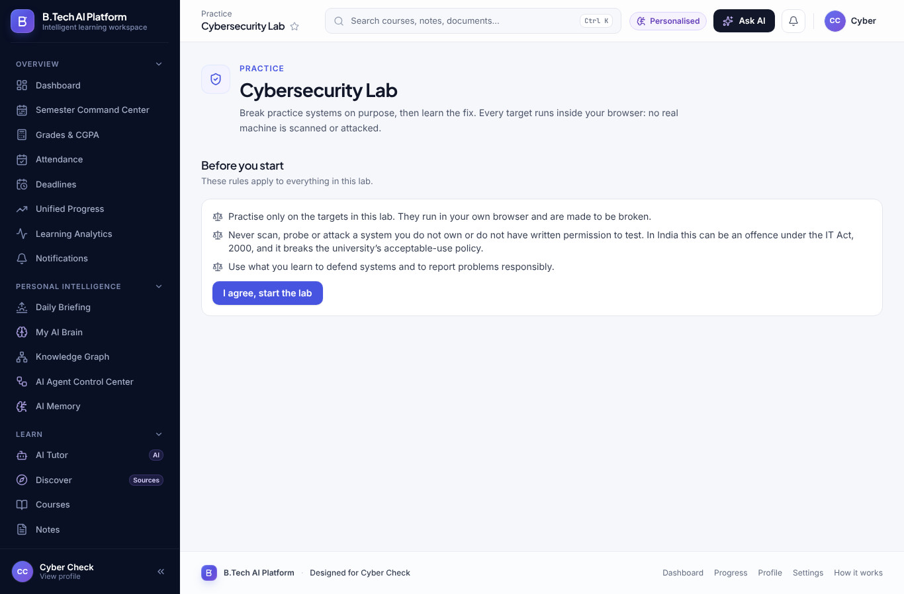
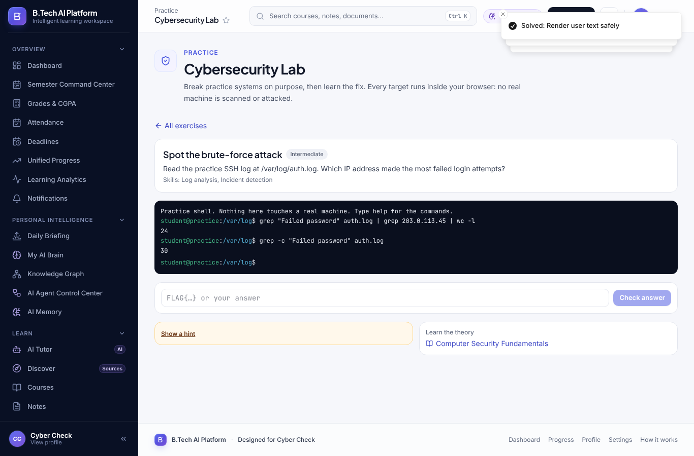
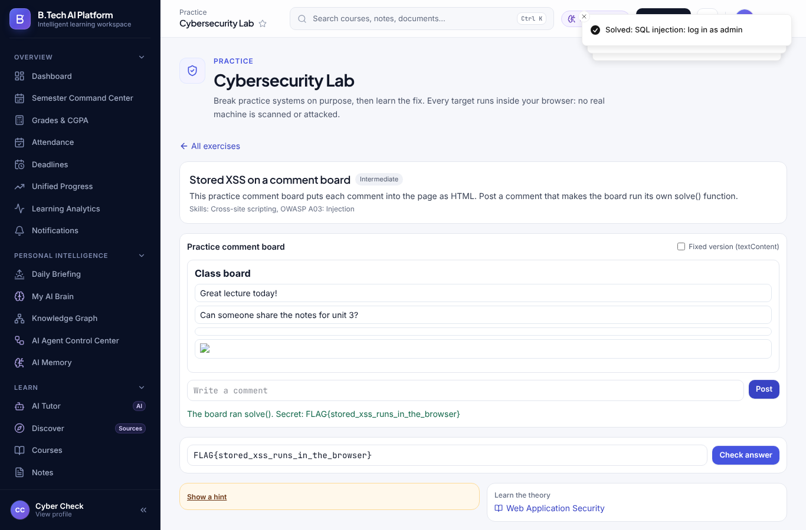
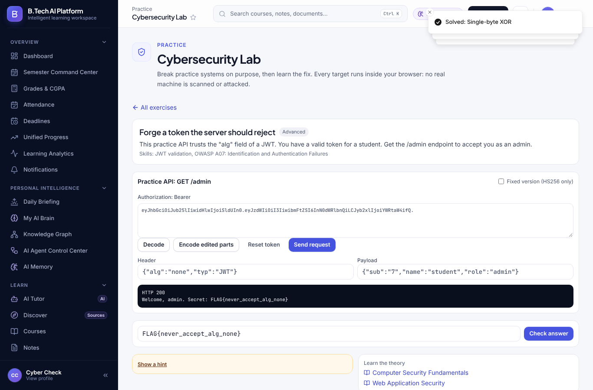

# Cybersecurity Lab (Module 12)

A legal, isolated place to practise security. Students break practice systems on purpose, then see the fix.
**Every target runs inside the student's own browser.** Nothing in the lab sends a packet to another machine,
and the server never runs a scan or an attack.

Page: **Practice → Cybersecurity Lab** (`/cybersecurity-lab`). API: `/api/v1/cybersecurity`.

## What is in it

| Track | Exercises (level) | Environment |
|---|---|---|
| Networking fundamentals | Usable hosts (1), network address (2), read a packet capture (2) | Questions, practice capture table |
| Linux and the command line | Hidden file (1), search a log (2), world-writable file (3) | Practice shell |
| Web application security (OWASP) | SQL injection login (1), stored XSS (2), IDOR (2) | Practice apps with a "fixed version" switch |
| Authentication security | Crack an unsalted hash (2), forge a JWT with alg none (3) | Hash tool, practice API |
| Cryptography fundamentals | Base64 (1), Caesar (2), single-byte XOR (3) | Decoding tools |
| Secure coding | Fix the query (1), store passwords (2), render user text (2) | Code and choices |
| Security analysis | Spot the brute force (2), which account was broken into (3) | Practice shell over an auth log |
| Capture the flag | The practice box (3) | Practice shell |

That is 20 exercises in 8 tracks. Each track links to the existing courses it builds on:
- Computer Networks
- Linux Fundamentals
- Operating Systems
- Web Application Security
- Computer Security Fundamentals

It also links to the Virtual Lab's subnetting simulator and to Code Review.

## How it is kept safe

- **Practice shell:** a simulated shell over a made-up file system, written in TypeScript. It has no
  network commands; `curl` or `nmap` answer "command not found".
- **SQL injection:** a SQLite database (sql.js, WebAssembly) created in the page with three practice users.
- **XSS:** the comment board runs in an `<iframe sandbox="allow-scripts">`. It has a separate, opaque
  origin, so it cannot read this page, its storage or the sign-in. It can only post one message back to say it was solved.
- **IDOR and JWT:** the "APIs" are functions in the page. The JWT key is random for each visit.
- **Practice data:** the logs and captures use only the IP ranges reserved for documentation (RFC 5737:
  192.0.2.0/24, 198.51.100.0/24, 203.0.113.0/24) and private ranges, which are never used on the internet. A test checks this.
- **Rules:** before the first exercise, the student accepts the lab rules. They are:
  - practise only on the lab's targets
  - never scan or attack a system you do not own or have written permission to test (this can be an offence under the IT Act, 2000)
  - report problems responsibly

  The server refuses answers until they are accepted.

## Progress and skills

- **Answers are checked on the server.** The browser never gets the accepted answers or the lessons
  for unsolved exercises, and a test checks that too.
- **What gets recorded:** only a correct answer marks an exercise as solved. The server records the time and the number of attempts.
- **Levels unlock in order** within a track, and the server enforces it.
- **Skills:** each exercise lists the skills it shows. "Skills you have shown" counts them from the solved
  exercises only. Progress is stored per student and kept across restarts (persistent store `cyberLab`).
- **After solving:** the student sees what happened and how to defend against it.

## Tested

- `src/tests/cybersecurity_lab.test.ts` (16 tests) covers:
  - the shell's commands, pipes and errors, and that it has no network tools
  - every crypto and hash exercise being solvable with the page's own tools
  - the JWT checker: the vulnerable one accepts "none", the fixed one does not
  - answers never leaving the server, and IP ranges
  - unlock order, course links pointing at real courses, and the sidebar entry
  - over HTTP: sign-in, rules first, locked levels, wrong and right answers, attempts, skills, bad input and student separation
- In Chromium, against the dev server and the production build:
  - all 20 exercises were solved through the page, using the shell, the practice apps and the tools as a student would
  - a wrong answer was refused
  - `<script>` in a comment did not run, but an `onerror` attribute did (the lesson)
  - the fixed IDOR version answered 403
  - the fixed JWT check refused "alg none"
  - the server reported 20/20 and 27 skills
  - nothing overflows at phone width
- Full suite: 87 files, 1,210 tests passing. `tsc` clean. Build passes.

## Limits

- The targets are teaching models, not full virtual machines. There is no real Linux kernel, network stack or web
  server to exploit. Running those safely would need isolated containers per student, which Vercel does not provide.
- The practice apps work out flags in the browser, so a determined student could read them in the developer tools.
  Solved exercises show practice, not proof. The answers for question exercises stay on the server.
