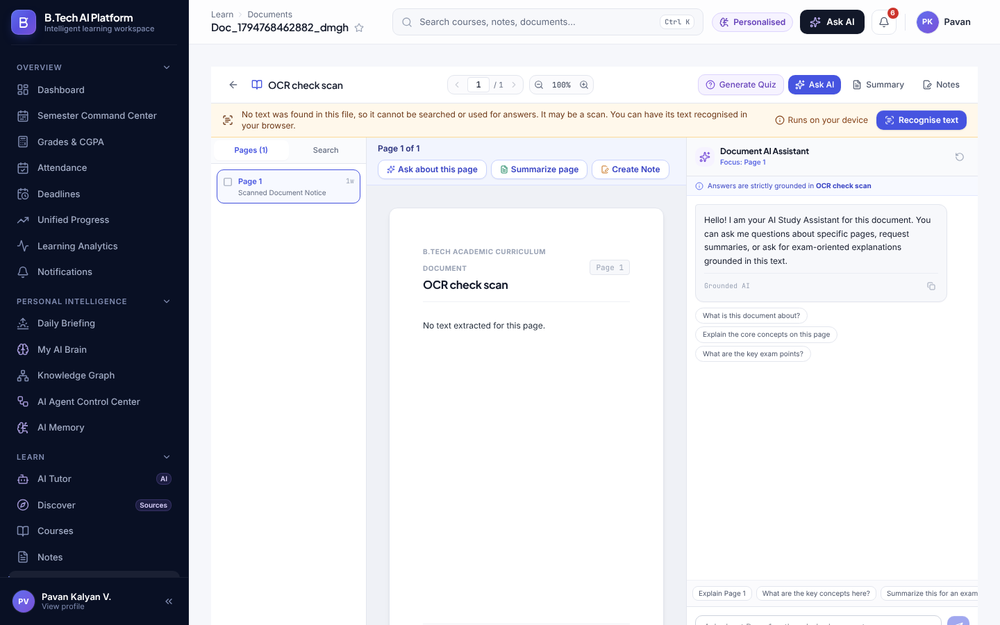
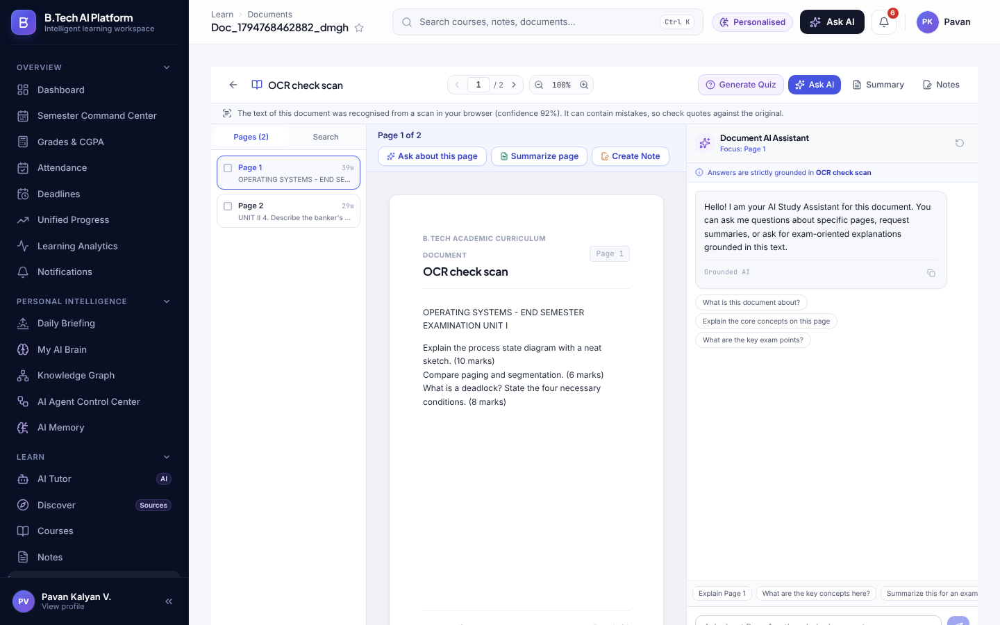
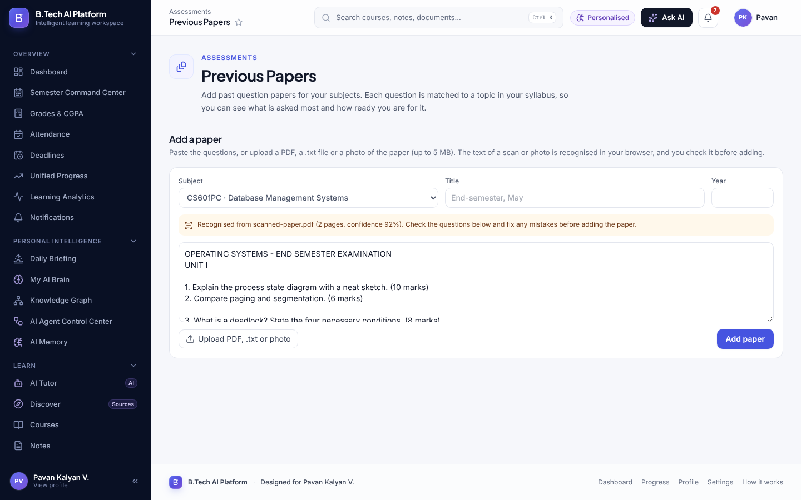
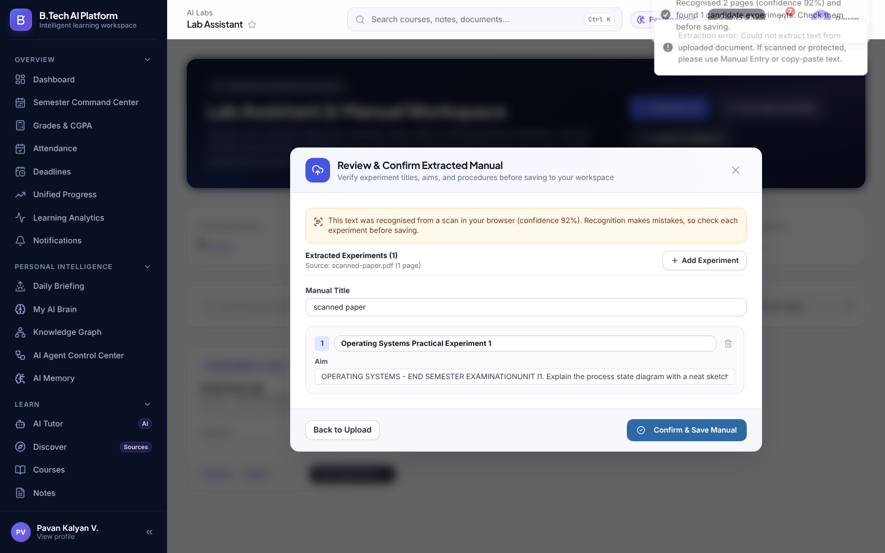

# Reading scanned PDFs and photos (OCR)

Scanned PDFs and photos of pages have no text of their own, so until now they could not be searched,
cited or split into questions. Text recognition (OCR) now runs **in the student's browser** with
Tesseract (compiled to WebAssembly) and its English model. Both are served from our own domain
(`/vendor/tesseract/`, copied from npm at install and build), so the file is never sent anywhere
to be read, and the Vercel server needs nothing new.

Recognition makes mistakes, so recognised text is always labelled as recognised, with its confidence,
and the student checks it before it is used.

## Where it is used

| Place | What happens |
|---|---|
| Documents | A scan or photo that finished processing with no text shows "No text was found… Recognise text". The page downloads the file, recognises each page (up to 40), and saves the pages through `POST /documents/:id/recognised-text`. The pages are then indexed like any other document, so search, citations, summaries and chat work. The document shows "recognised from a scan (confidence N%)". Each page keeps its own confidence. |
| Previous Papers | Choosing a scanned PDF or a photo shows "Recognise text". The recognised text fills the paste box with a note naming the file and confidence; the student fixes mistakes and adds the paper, which is marked "from a scan (recognised text)". |
| Lab manuals | When the server cannot find text in an uploaded PDF, the error offers "If it is a scan, recognise its text in your browser". Photos go straight to recognition. The text then goes through the existing experiment extraction, and the review step says it was recognised and must be checked. |

## Rules the server enforces

- Recognised text is only accepted for PDFs and images (`pdf`, `png`, `jpg`, `jpeg`, `webp`), and never
  replaces text that came from the file itself.
- Only the document's owner can save it. There are limits on pages (200) and characters per page (30,000).
  Page numbers must be distinct, and at least one page must have text.
- Processing the file again keeps the recognised pages instead of replacing them with empty ones.

## Fixes found on the way

- `GET /documents/:id/file` sent the stored data-URL text instead of the file's bytes, so a PDF
  or image could not be opened from it. It now sends the bytes.
- Images uploaded to Documents failed processing with "Unsupported document format". They are now kept
  as one page with no text (ready to be recognised) instead of failing.

## Tested

- `src/tests/ocr_recognised_text.test.ts` (5 tests) covers the following:
  - the file endpoint returns bytes
  - recognised pages are indexed with their confidence and are searchable
  - reprocessing keeps them, and recognising again replaces them
  - bad input, another student and documents with their own text are refused
  - a Previous Papers entry from a scan is marked as such
- End to end in Chromium used a two-page scanned exam paper made as an image-only PDF. Every word was read
  (confidence 93% and 91%, about 2 s for both pages):
  - Documents: the banner appeared, both pages were indexed, and a search for "banker's algorithm" found page 2. After reprocessing, both pages were still there.
  - Previous Papers: the text was recognised into the paste box, and adding the paper found 6 questions and stored it as from a scan.
  - Lab manual: the server refused the scan, recognition ran in the browser, and the review step opened with the recognition note.
- Full suite: 86 files, 1,194 tests passing. `tsc` clean.

## Limits

- English only. Handwriting, formulas, tables and poor scans come out worse; the confidence shows this.
- The first use downloads about 7 MB (engine and English model), which the browser then caches.
- Long PDFs are read up to 40 pages at a time in the browser, so a slow phone will take a while.
